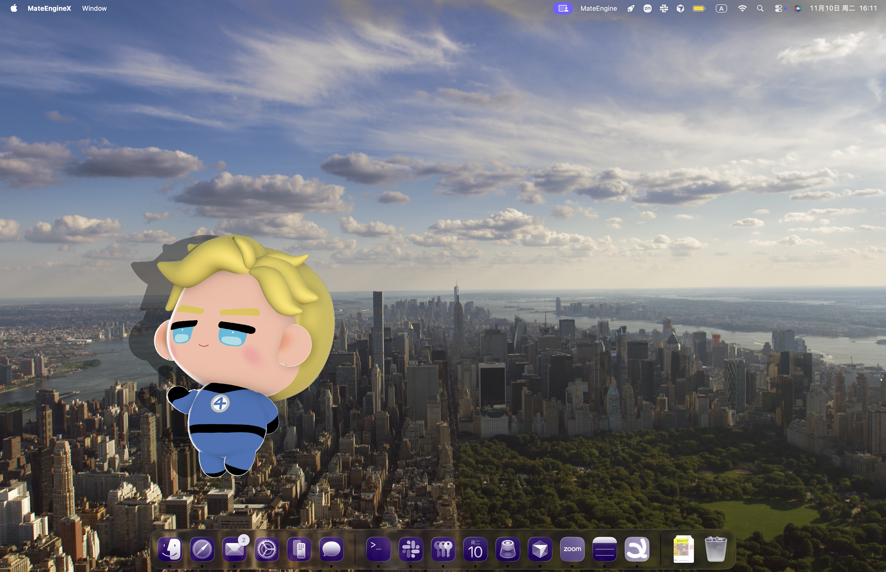
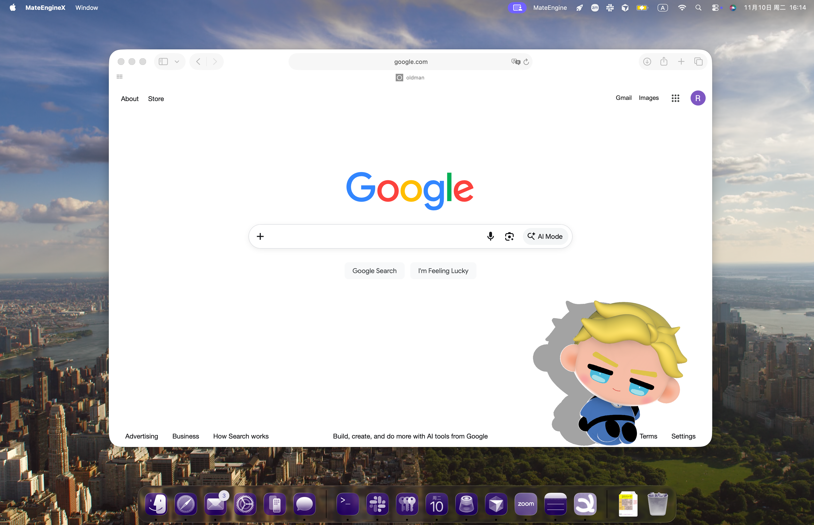
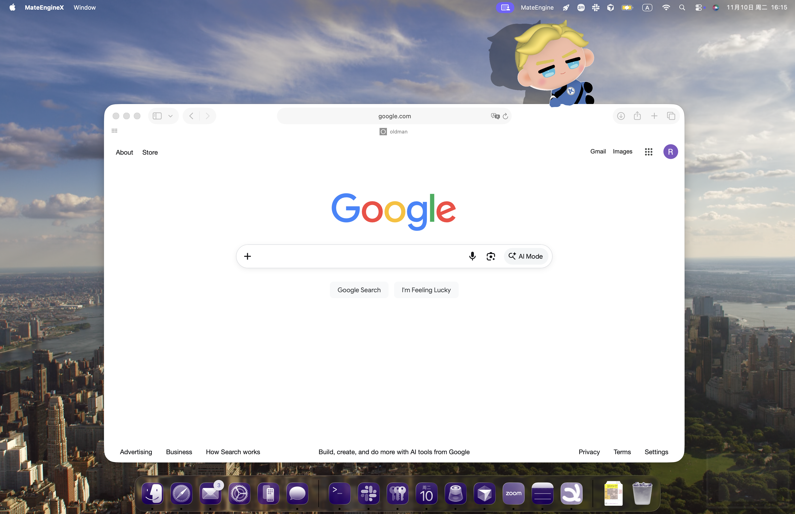

# johnny-storm-desktop-pet
Johnny Storm the Human Torch as a 3D desktop pet.

  
  
  

## 🚀 How to Use
1. Download and install MateEngine.
2. Download the .vrm file from this repository.
3. Launch MateEngine.
4. Import the downloaded VRM model.
5. Enjoy little Johnny companion!

## 🛠️ Made With
Blender, Krita and MateEngine

## 📜 Usage & Credits
This character model was created by the repository author.
Free for personal use. Please credit the original creator when sharing.
For commercial use or redistribution of modified versions, please contact the creator for permission.
